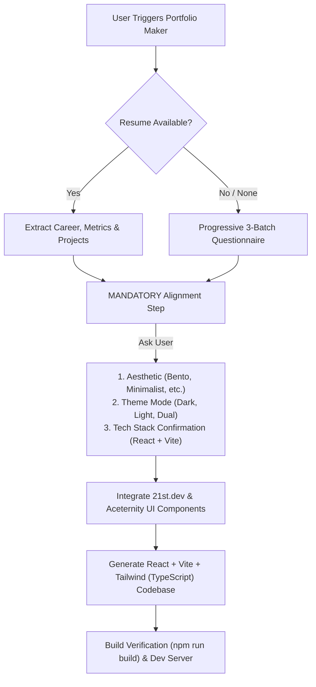

# ⚡ Portfolio Maker Skill

> **An intelligent, conversational AI skill that creates production-grade React + Vite + Tailwind CSS portfolios using modern component patterns from 21st.dev, Aceternity UI, and OriginUI.** Compatible with Antigravity, Claude Code, Cursor, Codex, and Gemini CLI.

[](LICENSE)
[](SKILL.md)
[](references/prompt-library.md)

---

## 🌟 What Makes Portfolio Maker Different?

1. **Default Stack is Modern React + Vite**:
   Unlike basic tools that output a static flat HTML file, Portfolio Maker builds a full, modular **React + Vite + Tailwind CSS (TypeScript)** application with Lucide React icons, Framer Motion transitions, and clean folder structures.
   *(Single-file HTML or Next.js are also supported when explicitly requested).*

2. **Mandatory Interactive Alignment Step**:
   The AI never guesses your design preferences. It conducts a resume check (or 3-batch fallback interview if you don't have one) and **explicitly asks** for your preferred:
   * **Visual Aesthetic**: Sleek Dark Bento (21st.dev/Linear style), Clean Minimalist (Apple/Swiss style), Neo-Brutalist, High-Contrast Editorial, or Bright & Vibrant.
   * **Theme Mode**: Dark Mode, Light Mode, or Dual Mode with an interactive toggle switch.

3. **Built-in 21st.dev & Aceternity Component Systems**:
   Generates real, modular UI primitives:
   * `SpotlightCard.tsx` (Radial mouse-tracking hover glow)
   * `BentoGrid.tsx` & `BentoCard.tsx` (Asymmetric layout with live status indicators)
   * `Terminal.tsx` (Interactive simulated developer CLI)
   * `CopyEmailButton.tsx` (OriginUI 1-click email copy with animated tooltip)
   * `ThemeToggle.tsx` (Persistent localStorage dark/light mode toggle)

---

## 🚀 Lifecycle & Workflow



---

## 📦 Installation Guide

Install Portfolio Maker into your favorite AI tool in seconds:

### 1. Antigravity & Gemini CLI (Official)
Clone or copy this repository into your project's workspace skills directory or your global configuration:

```bash
# Inside your project workspace
mkdir -p .agents/skills/portfolio-maker
git clone https://github.com/your-username/portfolio-maker.git .agents/skills/portfolio-maker

# OR as a global user skill across all projects:
# Windows: %USERPROFILE%\.gemini\config\skills\portfolio-maker
# macOS/Linux: ~/.gemini/config/skills/portfolio-maker
```

### 2. Claude Code
```bash
mkdir -p .claude/skills/portfolio-maker
cp SKILL.md .claude/skills/portfolio-maker/
```

### 3. Cursor & Codex
Copy the instructions from `SKILL.md` into your `.cursor/rules` or project `AGENTS.md`.

---

## 💻 Running a Generated Project

Once the AI builds your React + Vite portfolio:

```bash
cd <your-portfolio-folder>
npm install
npm run dev
```

To build for production:
```bash
npm run build
npm run preview
```

---

## 📖 File Architecture

```text
portfolio-maker/
├── SKILL.md                     # Main skill definition & operating instructions
├── README.md                    # Repository documentation & guide
├── references/
│   ├── questionnaire.md         # 3-batch resume fallback intake questionnaire
│   ├── design-systems.md        # Color palettes, typography & theme architectures
│   ├── archetypes.md            # Role-specific blueprints (Dev, Video, Design, etc.)
│   └── prompt-library.md        # 21st.dev, Aceternity & OriginUI React TSX components
├── templates/
│   ├── developer-bento/         # Reference developer bento implementation
│   ├── video-editor-showreel/   # Reference video editor showreel implementation
│   └── creative-minimalist/     # Reference minimalist editorial implementation
└── examples/
    ├── scenario-1-developer-with-resume.md
    ├── scenario-2-video-editor-no-resume.md
    ├── scenario-3-designer-minimalist.md
    └── scenario-4-junior-student-vibrant.md
```

## 📄 License

Distributed under the [MIT License](LICENSE).
