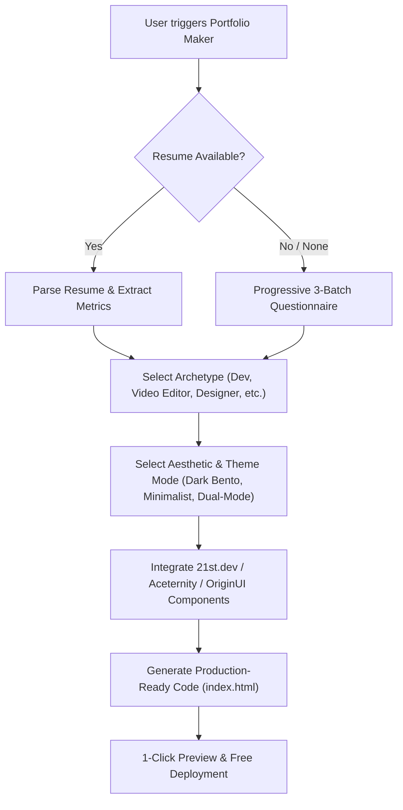

# ⚡ Portfolio Maker Skill

> **An intelligent, conversational AI skill that turns any AI assistant into an elite design engineer and portfolio creator.** Compatible with Antigravity, Claude Code, Cursor, Codex, Gemini CLI, and custom agent workflows.

[](LICENSE)
[](SKILL.md)
[](https://tailwindcss.com)
[](#-quick-start)

---

## 🌟 What is Portfolio Maker?

**Portfolio Maker** teaches your AI how to systematically interview you, parse your professional background, extract quantifiable impact, and craft a responsive, modern portfolio website tailored to your exact role and aesthetic taste.

Whether you have a 10-page executive resume or **no resume at all**, Portfolio Maker guides the AI through an interactive intake, recommends archetypes and styles, and outputs production-ready code with interactive light/dark themes, smooth animations, and zero build tool requirements.

---

## 🚀 How It Works (The 6-Step Engine)



---

## 📦 Installation Guide

Install Portfolio Maker into your favorite AI tool in seconds:

### 1. Antigravity & Gemini CLI (Official)
Clone or copy this repository into your project's workspace skills directory or your global configuration:

```bash
# Inside your project workspace
mkdir -p .agents/skills/portfolio-maker
git clone https://github.com/your-username/portfolio-maker.git .agents/skills/portfolio-maker

# OR as a global user skill across all projects:
# Windows: %USERPROFILE%\.gemini\config\skills\portfolio-maker
# macOS/Linux: ~/.gemini/config/skills/portfolio-maker
```

### 2. Claude Code
Add to your project's skills or prompt instructions:
```bash
mkdir -p .claude/skills/portfolio-maker
cp SKILL.md .claude/skills/portfolio-maker/
```

### 3. Cursor & Codex
Copy the instructions from `SKILL.md` into your `.cursor/rules` or project `AGENTS.md`.

### 4. Direct / Any AI (ChatGPT, Claude Web, Gemini)
Simply upload or paste [SKILL.md](./SKILL.md) and tell the AI:
> *"Act as the Portfolio Maker skill. Let's create my personal portfolio!"*

---

## 🎯 Key Features & Capabilities

### 1. Smart Resume Intake & Fallback Questionnaire
* **Resume Autodetection**: Automatically parses `.pdf`, `.docx`, `.txt`, `.md`, or pasted LinkedIn exports.
* **Intelligent Fallback Protocol**: If you say *"I don't have a resume"*, the AI never leaves you hanging. It runs a lightweight **3-batch progressive questionnaire**:
  * **Batch 1**: Name, title, elevator pitch hook, contact/socials, availability badge.
  * **Batch 2**: Experience history, metrics, and top 2-4 featured projects.
  * **Batch 3**: Categorized tools/skills, certifications, client logos, or testimonials.

### 2. Tailored Profession Archetypes
Every profession requires a distinct layout and set of signature widgets:

| Archetype | Key Focus | Signature Widgets |
| :--- | :--- | :--- |
| **Software Engineer** | Code quality, distributed systems, shipping speed | Interactive terminal (`whoami`, CLI commands), Bento grid, GitHub stats, architecture diagrams. |
| **Video Editor / Motion Artist** | Visual pacing, audience retention, turnaround time | Click-to-play Showreel Modal, view counters (`75M+ Views`), Before/After color grade breakdown, software dock. |
| **UI/UX & Product Designer** | User impact, design systems, narrative clarity | Flagship case study breakdowns (Problem → Solution → Metric), Figma token showcase, design philosophy. |
| **Content Creator / Marketer** | Engagement, brand partnerships, reach | Follower counters, engagement percentage, brand collaborations carousel, media kit download. |
| **Student / Career Switcher** | Learning velocity, passion projects, fundamentals | Project deep-dives, hackathon wins, course milestones, "Why Hire Me" pitch. |

### 3. Aesthetics & Visual Styles
* **Sleek Tech / Dark Bento**: Frosted glass cards, subtle neon radial glow, spotlight hover effect (21st.dev / Linear style).
* **Clean Minimalist**: Swiss grid, generous whitespace, crisp monochromatic typography (Dieter Rams / Apple style).
* **High-Contrast Editorial**: Elegant serif headlines (Playfair / Cormorant), magazine aesthetic, luxury agency vibe.
* **Neo-Brutalism**: Solid 2px black borders, vibrant pop colors (lime, cyan, lilac), hard drop shadows (`shadow-[4px_4px_0px_0px_#000]`).
* **Bright & Vibrant**: Warm gradients, rounded cards, playful micro-interactions.

### 4. High-End UI Component Patterns Built-In
Inspired by top design registries:
* **21st.dev & shadcn**: Bento grid asymmetric tiles, animated live dot badges.
* **Aceternity UI & Animos**: Spotlight glow cards that track mouse movement.
* **OriginUI & Micrograph**: 1-click "Copy Email" pill with copied tooltip, persistent dark/light theme switchers.
* **Flows & Motion**: Video showreel modal, filterable project tabs, smooth mobile hamburger drawer.

---

## 🎨 Included Production Templates

This repository includes 3 fully functional, standalone reference templates:

* **[templates/developer-bento/index.html](./templates/developer-bento/index.html)**:
  Full dual-mode Software Engineer portfolio with interactive terminal, bento grid, and career timeline.
* **[templates/video-editor-showreel/index.html](./templates/video-editor-showreel/index.html)**:
  High-retention Video Editor portfolio with auto-play showreel modal, metric counters, and color grading comparison.
* **[templates/creative-minimalist/index.html](./templates/creative-minimalist/index.html)**:
  Swiss-inspired Product Designer portfolio with serif typography, case study breakdowns, and design philosophy cards.

---

## 💻 Zero-Build Live Preview

Test or preview any portfolio instantly using the bundled zero-dependency Python server:

```bash
# Serve the Developer Bento template:
python scripts/serve.py templates/developer-bento

# Serve the Video Editor Showreel template:
python scripts/serve.py templates/video-editor-showreel

# Serve the Minimalist Designer template:
python scripts/serve.py templates/creative-minimalist
```
*Your browser will automatically open to `http://localhost:3000`.*

---

## 🧪 Tested Scenarios

Explore realistic simulated walkthroughs in the [examples/](./examples/) directory:
1. **[Scenario 1: Senior Full-Stack Engineer with Resume](./examples/scenario-1-developer-with-resume.md)**
2. **[Scenario 2: Video Editor & Motion Artist without Resume](./examples/scenario-2-video-editor-no-resume.md)**
3. **[Scenario 3: UI/UX & Product Designer (Minimalist Editorial)](./examples/scenario-3-designer-minimalist.md)**
4. **[Scenario 4: Junior Developer / Student (Bright & Vibrant)](./examples/scenario-4-junior-student-vibrant.md)**

---

## 🚢 1-Click Free Deployment

Once the AI generates your portfolio:

1. **GitHub Pages (Free)**:
   * Push your code to a GitHub repo.
   * Go to **Settings > Pages** and select `main` branch.
   * Your site is live at `https://<username>.github.io/<repo>/`!

2. **Vercel / Netlify (Free)**:
   * Drag and drop the folder into [Vercel](https://vercel.com) or [Netlify](https://netlify.com) for instant SSL and custom domain support.

---

## 📖 File Architecture

```text
portfolio-maker/
├── SKILL.md                     # Main skill definition & AI operating instructions
├── README.md                    # Repository documentation & guide
├── LICENSE                      # MIT License
├── scripts/
│   └── serve.py                 # Instant zero-dependency local preview server
├── references/
│   ├── questionnaire.md         # 3-batch resume fallback intake questionnaire
│   ├── design-systems.md        # Color palettes, typography & theme architectures
│   ├── archetypes.md            # Role-specific blueprints (Dev, Video, Design, etc.)
│   └── prompt-library.md        # 21st.dev, Animos & OriginUI copy-paste components
├── templates/
│   ├── developer-bento/         # Full standalone Developer Bento template
│   ├── video-editor-showreel/   # Full standalone Video Editor Showreel template
│   └── creative-minimalist/     # Full standalone Minimalist Editorial template
└── examples/
    ├── scenario-1-developer-with-resume.md
    ├── scenario-2-video-editor-no-resume.md
    ├── scenario-3-designer-minimalist.md
    └── scenario-4-junior-student-vibrant.md
```

---

## 🤝 Contributing

Contributions, new archetype blueprints, and fresh design component templates are welcome! Feel free to open a Pull Request or issue.

## 📄 License

Distributed under the [MIT License](LICENSE).
