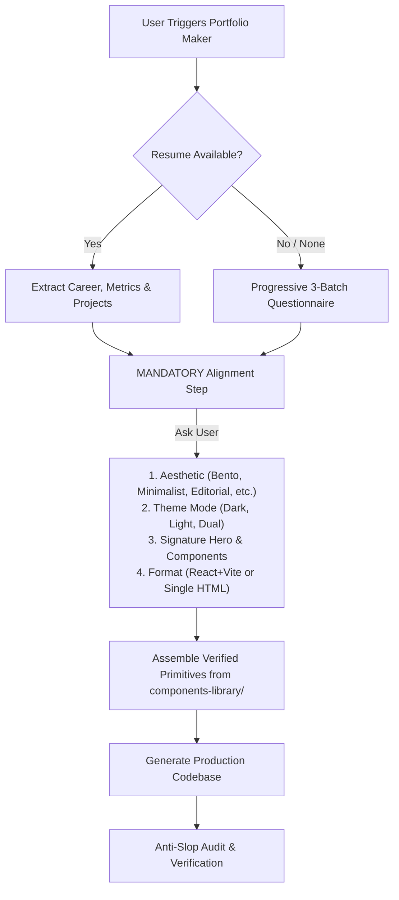

# ⚡ Portfolio Maker: Sovereign AI Portfolio Engineering Skill

> **A self-contained, sovereign AI skill that empowers any AI assistant to build world-class, production-grade portfolios with built-in aesthetic taste, mathematical typographic hierarchy, strict anti-slop rules, verified 21st.dev component primitives, and instant dual delivery (React + Vite or standalone single-file HTML).** Compatible with Antigravity, Claude Code, Cursor, Codex, and Gemini CLI.

[](LICENSE)
[](SKILL.md)
[](references/21st-dev-catalog.md)

---

## 🌟 The Anti-AI-Slop Revolution

When standard AI agents generate portfolios, they fall into predictable traps:
* Flat, uninspired Tailwind gray boxes with zero elevation.
* Cliché purple-to-pink neon gradients and giant blurry purple background orbs.
* Generic placeholder copy (*"Passionate developer crafting digital solutions"*).

**Portfolio Maker permanently solves this through a self-contained, sovereign design system:**
1. **Built-in Aesthetic Engine**: Native typographic scale ratios, 8pt spatial grid, surface elevation, and hairline borders (`border-white/[0.08]`). No third-party skills needed.
2. **Strict Anti-Slop Enforcement**: Hard bans on purple neon gradients, synthwave borders, and generic AI copy. All text is metric-driven and concrete.
3. **Dual Delivery Modes**:
   * **React + Vite + Tailwind CSS (TypeScript)** for modular, scalable web apps.
   * **Instant Standalone Single-File HTML** with Tailwind CDN, Google Fonts, Lucide Icons, and zero dependencies for instant preview and deployment.
4. **Authentic 21st.dev Component Primitives**: Direct access to 9 standalone hero sections, interactive 3D tilt cards, bento grids, before/after sliders, video modals, terminal CLI widgets, and 11,750+ indexed components.
5. **Zero API Key Requirement**: Instructs the AI to leverage the official, 100% free **shadcn MCP server** (`npx shadcn@latest mcp`) to install official or remote 21st.dev registry components with zero cost and no API keys.
6. **Premium Template & Motion Design Ecosystems**: Direct architectural inspiration from **VibeUI** (`vibeui.dev`), **Trical** (`trical.so`), and **Motion** (`motion.site.ai`) for kinetic typography, floating glass docks, and editorial case-study layouts.

---

## 🧩 Built-in 21st.dev & Aceternity Component Primitives

The skill comes bundled with verified, production-grade components ready for instant use:

### 1. Signature Heroes (`components-library/heroes/`)
* **`ImageStreamHero.tsx`**: Vanishing-point streaming rails with depth (creators & video editors).
* **`PerspectiveTunnelHero.tsx`**: 3D Z-axis spatial perspective with live metrics (engineers & architects).
* **`ProductRailGallery.tsx`**: Interactive clothing rack with swinging physics (e-commerce & fashion).
* **`TiltedGridHero.tsx`**: Curved 3D image stream bending toward viewer (UI/UX designers & photographers).
* **`PrismHero.tsx`**: Chromatic crystal refraction shader aesthetic (art directors & luxury portfolios).
* **`TigerTearRevealHero.tsx`**: Interactive tear reveal slogan effect (high-impact creatives).
* **`AgencyHero01.tsx`**: High-trust agency hero with social avatars and rating badges (freelancers & agencies).
* **`ResponsiveHeroBanner.tsx`**: Cinematic banner with glassmorphic navigation (founders & leads).
* **`CenteredImageFanHero.tsx`**: Highlighted headline with 3-image fan collage (product designers).

### 2. Standalone Primitives (`components-library/`)
* **Backgrounds**: `backgrounds/AuroraBackground.tsx` (subtle emerald/cyan/slate waves, zero neon purple).
* **Interactive Cards**: `cards/SpotlightCard.tsx` (cursor-following glow), `cards/Card3D.tsx` (perspective tilt), `cards/BorderBeam.tsx` (animated hairline beam), `cards/Meteors.tsx` (shooting star trails).
* **Sections & Layouts**: `sections/BentoGrid.tsx` (asymmetric responsive grid), `sections/InfiniteMarquee.tsx` (infinite tech ticker), `sections/BeforeAfterSlider.tsx` (swipe comparison slider), `sections/VideoModal.tsx` (cinematic video popup), `sections/TerminalWidget.tsx` (simulated interactive CLI).
* **UI Controls**: `ui/FloatingNav.tsx` (floating glassmorphic pill navbar), `ui/ShimmerButton.tsx` (shimmering action button), `ui/TextGenerateEffect.tsx` (staggered word reveal), `ui/CopyEmailButton.tsx` (one-click copy pill), `ui/ThemeToggle.tsx` (dark/light theme toggle).

---

## 🗂️ Master 21st.dev Catalog (11,750+ Components Indexed)

Explore the master catalog in [`components-library/catalog/INDEX.md`](./components-library/catalog/INDEX.md) covering every component category with direct links and `npx shadcn` install commands:

* [**Heroes & Headers**](./components-library/catalog/heroes.md) (396 components)
* [**Buttons & Triggers**](./components-library/catalog/buttons.md) (422 components)
* [**Backgrounds & Shaders**](./components-library/catalog/backgrounds.md) (470 components)
* [**Features & Bento Grids**](./components-library/catalog/features.md) (855 components)
* [**Galleries & Carousels**](./components-library/catalog/galleries.md) (318 components)
* [**Navigation & Docks**](./components-library/catalog/navigation-menus.md) (351 components)
* [**Sky Arts & ASCII Illustrations**](./components-library/catalog/sky-arts.md) (298 components)
* [**Call to Action (CTA)**](./components-library/catalog/call-to-action.md) (76 components)
* [**Client Comparisons & Sliders**](./components-library/catalog/client-comparisons.md) (44 components)
* [**Footers**](./components-library/catalog/footers.md) (74 components)
* [**Pricing Tiers**](./components-library/catalog/pricing-sections.md) (79 components)
* [**FAQs & Accordions**](./components-library/catalog/faqs.md) (173 components)
* [**Announcements & Alerts**](./components-library/catalog/announcements.md) (183 components)
* [**Terminals & Markups**](./components-library/catalog/markups.md) (96 components)
* [**Maps & 3D Globes**](./components-library/catalog/maps.md) (77 components)
* [**Gradients & Glows**](./components-library/catalog/gradients.md) (131 components)
* [**Borders & Beams**](./components-library/catalog/borders.md) (52 components)
* [**Hooks & Utilities**](./components-library/catalog/hooks.md) (230 components)
* [**Images & Avatars**](./components-library/catalog/images.md) (190 components)
* [**Docs & Step-by-Steps**](./components-library/catalog/docs.md) (85 components)
* [**Testimonials & Social Proof**](./components-library/catalog/testimonials.md) (112 components)

---

## 🎨 Tested Reference Templates

The repository includes production-tested standalone HTML references showcasing pristine execution of the archetypes:

1. **Developer Bento Showcase** (`templates/developer-bento/index.html`): High-throughput systems engineer portfolio with live availability pill, dark/light toggle, metrics bento, and terminal widget.
2. **Creative Minimalist** (`templates/creative-minimalist/index.html`): Product design systems portfolio with Cormorant Garamond serif headings, generous whitespace, and case studies.
3. **Video Editor & Motion Showreel** (`templates/video-editor-showreel/index.html`): High-retention video editor portfolio with 16:9 video embeds, before/after color grade comparison, and showreel modal.

---

## 🚀 Lifecycle & Workflow



---

## 📦 Installation Guide

Install Portfolio Maker into your favorite AI tool in seconds:

### 1. Antigravity & Gemini CLI (Official)
```bash
# Inside your project workspace
mkdir -p .agents/skills/portfolio-maker
git clone https://github.com/your-username/portfolio-maker.git .agents/skills/portfolio-maker

# OR as a global user skill across all projects:
# Windows: %USERPROFILE%\.gemini\config\skills\portfolio-maker
# macOS/Linux: ~/.gemini/config\skills/portfolio-maker
```

### 2. Claude Code
```bash
mkdir -p .claude/skills/portfolio-maker
cp -r * .claude/skills/portfolio-maker/
```

### 3. Cursor & Codex
Copy the instructions from `SKILL.md` into your `.cursor/rules` or project `AGENTS.md`.

---

## 📖 File Architecture

```text
portfolio-maker/
├── SKILL.md                     # Sovereign skill definition & operating instructions
├── README.md                    # Repository documentation & guide
├── components-library/          # Verified 21st.dev & Aceternity UI React primitives
│   ├── heroes/                  # 9 standalone 21st.dev hero sections
│   ├── backgrounds/             # Ambient backgrounds (AuroraBackground)
│   ├── cards/                   # SpotlightCard, Card3D, BorderBeam, Meteors
│   ├── sections/                # BentoGrid, InfiniteMarquee, BeforeAfterSlider, etc.
│   ├── ui/                      # FloatingNav, ShimmerButton, CopyEmailButton, etc.
│   └── catalog/                 # 22 category markdown files with 11,750+ indexed components
├── templates/                   # Standalone HTML production reference templates
│   ├── developer-bento/         # Systems engineer bento portfolio
│   ├── creative-minimalist/     # Product designer Swiss minimalist portfolio
│   └── video-editor-showreel/   # Video editor & motion creator showreel
├── references/                  # Design systems, archetypes, prompt recipes, questionnaires
│   ├── design-systems.md
│   ├── archetypes.md
│   ├── 21st-dev-catalog.md
│   ├── prompt-library.md
│   └── questionnaire.md
└── scripts/
    └── serve.py                 # Zero-dependency local preview server
```

## 📄 License

Distributed under the [MIT License](LICENSE).
