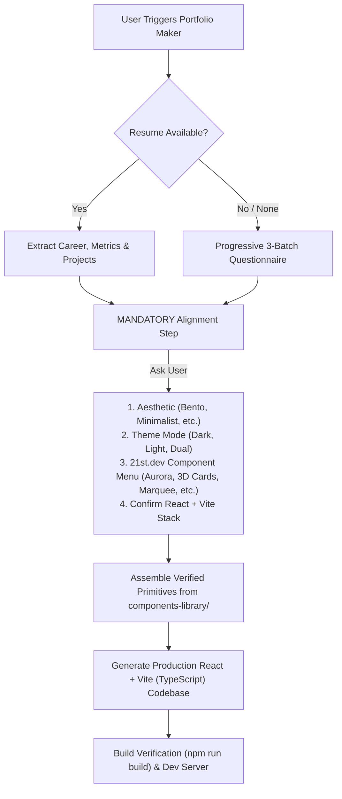

# ⚡ Portfolio Maker Skill

> **An intelligent, conversational AI skill that creates production-grade React + Vite + Tailwind CSS portfolios using pre-built modern component primitives from 21st.dev, Aceternity UI, and OriginUI.** Compatible with Antigravity, Claude Code, Cursor, Codex, and Gemini CLI.

[](LICENSE)
[](SKILL.md)
[](references/21st-dev-catalog.md)

---

## 🌟 Why Generic AI Portfolios Look Bad (and How This Solves It)

When general AI models are asked to "make a portfolio", they tend to write flat, generic Tailwind boilerplate with plain colored boxes and basic borders.

**Portfolio Maker solves this by embedding an authentic, battle-tested component library directly into the skill**:
* The AI **does not** code basic cards from scratch.
* The AI assembles the portfolio using verified **21st.dev**, **Aceternity UI**, **Magic UI**, and **OriginUI** React primitives.
* The AI gives the user a component menu to pick their favorite hero effects, project cards, and interactive widgets.

---

## 🧩 Built-in 21st.dev & Aceternity Component Library

The repository includes ready-to-import React TypeScript components inside [`components-library/`](./components-library/):

### 1. Backgrounds & Hero
* **`AuroraBackground.tsx`**: Fluid animated northern lights mesh gradient.
* **`TextGenerateEffect.tsx`**: Staggered blur-in word reveal effect.
* **`FloatingNav.tsx`**: Floating pill navigation bar with frosted glass backdrop blur and active tab indicator.

### 2. High-Impact Project Cards
* **`SpotlightCard.tsx`**: Radial mouse-tracking cursor spotlight hover effect.
* **`Card3D.tsx`**: 3D perspective tilt reacting to mouse position with pop-out layers (`translateZ`).
* **`BorderBeam.tsx`**: Continuous animated neon border beam travelling around featured cards.
* **`Meteors.tsx`**: Animated shooting star trails behind dark cards.

### 3. Interactive Showcases & Media
* **`BentoGrid.tsx`**: Responsive asymmetric bento grid layout with live indicator dots.
* **`TerminalWidget.tsx`**: Simulated interactive developer CLI with typing output.
* **`BeforeAfterSlider.tsx`**: Interactive swipe slider comparing raw vs. graded footage or before/after redesigns.
* **`InfiniteMarquee.tsx`**: Smooth, infinite continuous scrolling ticker for logos and tech stacks.
* **`VideoModal.tsx`**: Click-to-play modal video player with backdrop blur.

### 4. Tactile Micro-Interactions
* **`ShimmerButton.tsx`**: Tactile button with a rotating 360° light beam border.
* **`CopyEmailButton.tsx`**: OriginUI-style 1-click email copy with animated tooltip toast.
* **`ThemeToggle.tsx`**: Smooth sun/moon icon toggle with persistent `localStorage` dark/light modes.

---

## 🗂️ Master 21st.dev Catalog (9,600+ Components Indexed)

The skill includes a complete indexed catalog directly from **21st.dev** in [`components-library/catalog/INDEX.md`](./components-library/catalog/INDEX.md) covering every component category with direct links and `npx shadcn` install commands:

* [**Heroes & Headers**](./components-library/catalog/heroes.md) (396 components)
* [**Buttons & Triggers**](./components-library/catalog/buttons.md) (422 components)
* [**Backgrounds & Shaders**](./components-library/catalog/backgrounds.md) (470 components)
* [**Features & Bento Grids**](./components-library/catalog/features.md) (855 components)
* [**Galleries & Carousels**](./components-library/catalog/galleries.md) (318 components)
* [**Navigation & Docks**](./components-library/catalog/navigation-menus.md) (351 components)
* [**Sky Arts & ASCII Illustrations**](./components-library/catalog/sky-arts.md) (298 components)
* [**Call to Action (CTA)**](./components-library/catalog/call-to-action.md) (76 components)
* [**Client Comparisons & Sliders**](./components-library/catalog/client-comparisons.md) (44 components)
* [**Footers**](./components-library/catalog/footers.md) (74 components)
* [**Pricing Tiers**](./components-library/catalog/pricing-sections.md) (79 components)
* [**FAQs & Accordions**](./components-library/catalog/faqs.md) (173 components)
* [**Announcements & Alerts**](./components-library/catalog/announcements.md) (183 components)
* [**Terminals & Markups**](./components-library/catalog/markups.md) (96 components)
* [**Maps & 3D Globes**](./components-library/catalog/maps.md) (77 components)
* [**Gradients & Glows**](./components-library/catalog/gradients.md) (131 components)
* [**Borders & Beams**](./components-library/catalog/borders.md) (52 components)
* [**Hooks & Utilities**](./components-library/catalog/hooks.md) (230 components)
* [**Images & Avatars**](./components-library/catalog/images.md) (190 components)
* [**Docs & Step-by-Steps**](./components-library/catalog/docs.md) (85 components)
* [**Testimonials & Social Proof**](./components-library/catalog/testimonials.md) (112 components)

*(See [references/21st-dev-catalog.md](./references/21st-dev-catalog.md) for full recipe combinations).*

---

## 🚀 Lifecycle & Workflow



---

## 📦 Installation Guide

Install Portfolio Maker into your favorite AI tool in seconds:

### 1. Antigravity & Gemini CLI (Official)
```bash
# Inside your project workspace
mkdir -p .agents/skills/portfolio-maker
git clone https://github.com/your-username/portfolio-maker.git .agents/skills/portfolio-maker

# OR as a global user skill across all projects:
# Windows: %USERPROFILE%\.gemini\config\skills\portfolio-maker
# macOS/Linux: ~/.gemini/config/skills/portfolio-maker
```

### 2. Claude Code
```bash
mkdir -p .claude/skills/portfolio-maker
cp -r * .claude/skills/portfolio-maker/
```

### 3. Cursor & Codex
Copy the instructions from `SKILL.md` into your `.cursor/rules` or project `AGENTS.md`.

---

## 📖 File Architecture

```text
portfolio-maker/
├── SKILL.md                     # Main skill definition & operating instructions
├── README.md                    # Repository documentation & guide
├── components-library/          # Verified 21st.dev & Aceternity UI React primitives
│   ├── backgrounds/
│   │   └── AuroraBackground.tsx
│   ├── cards/
│   │   ├── SpotlightCard.tsx
│   │   ├── Card3D.tsx
│   │   ├── BorderBeam.tsx
│   │   └── Meteors.tsx
│   ├── sections/
│   │   ├── BentoGrid.tsx
│   │   ├── InfiniteMarquee.tsx
│   │   ├── BeforeAfterSlider.tsx
│   │   ├── VideoModal.tsx
│   │   └── TerminalWidget.tsx
│   └── ui/
│       ├── ShimmerButton.tsx
│       ├── FloatingNav.tsx
│       ├── TextGenerateEffect.tsx
│       ├── CopyEmailButton.tsx
│       └── ThemeToggle.tsx
├── references/
│   ├── 21st-dev-catalog.md      # Master component menu & composition recipes
│   ├── questionnaire.md         # 3-batch resume fallback intake questionnaire
│   ├── design-systems.md        # Color palettes, typography & theme architectures
│   ├── archetypes.md            # Role-specific blueprints (Dev, Video, Design, etc.)
│   └── prompt-library.md        # Component patterns and usage recipes
└── examples/
    ├── scenario-1-developer-with-resume.md
    ├── scenario-2-video-editor-no-resume.md
    ├── scenario-3-designer-minimalist.md
    └── scenario-4-junior-student-vibrant.md
```

## 📄 License

Distributed under the [MIT License](LICENSE).
